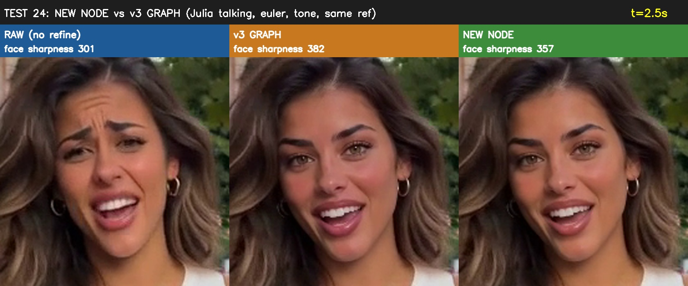
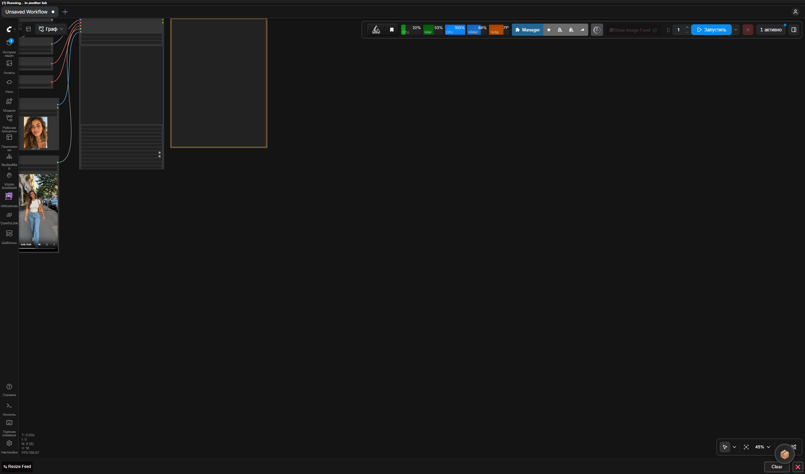
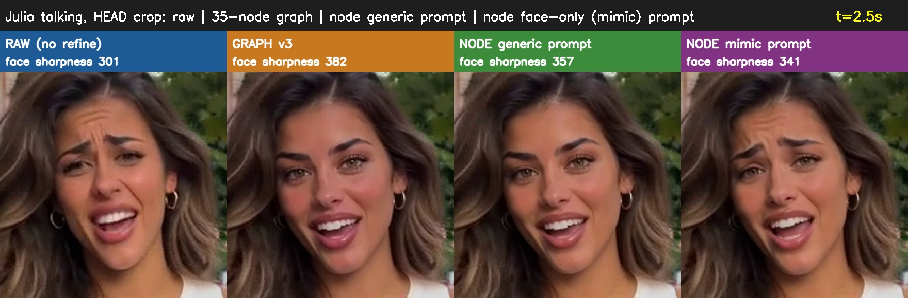
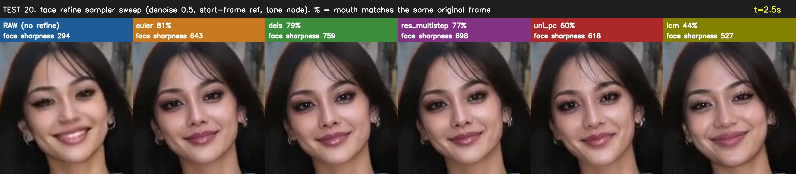

# Artfat H3 Face Refine (chunked)

A ComfyUI node that sharpens **small or distant faces** in a finished **MiniMax H3** video, while keeping the
**lip-sync, the expression and the skin tone** of the original. Long videos are processed in chunks, so memory use
does not grow with the length of the clip.

Free and open source (GPL-3.0-or-later). One node replaces a 35-node graph.



## What it does

In a full-body or wide H3 shot the face is often only 60–150 px tall, so eyes, lashes and lips come out soft. The node:

1. **Tracks the face** and crops a square around it (2.5× the face size), scaled to 768 × 768.
2. **Masks only the face** with SAM 3.1 (threshold 0.15; frames where the mask drops out borrow the neighbour's mask).
3. **Redraws the face** with a second H3 Reference-to-Video pass at denoise 0.5:
   - the mask goes into the latent with DifferentialDiffusion, so only the face changes;
   - the original audio stays in the latent untouched, which is why the mouth keeps following the voice.
4. **Polishes** the crop with VOSR2 (optional).
5. **Matches the skin tone** to the original, measuring skin only (brows, eyes and teeth are excluded).
6. **Pastes the face back** through the SAM mask and writes the frames straight to an mp4 with the original audio.

## Results (19 Nov 2026, RTX 3090 24 GB)

| Clip | Face size | Result |
|---|---|---|
| Talking + laughing, 141 frames | 100–224 px | python RAM peak 37 GB; the 35-node graph needed 53+ GB and crashed |
| Talking, Julia | 100–144 px | as sharp as the graph; skin tone much closer to raw (Lab L −2.2 vs −7.6) |
| Talking, Blanca | 33–128 px | lip-sync kept; the graph ran out of memory on this clip |

Examples (head crop and full frame, with sound) are in [`examples/`](examples):

| Folder | What it compares |
|---|---|
| [01_mina_talk](examples/01_mina_talk) | raw · 35-node graph · node |
| [02_julia_talk](examples/02_julia_talk) | raw · 35-node graph · node |
| [03_blanca_talk](examples/03_blanca_talk) | raw · node (the graph crashed on this clip) |
| [04_julia_mimic_prompt](examples/04_julia_mimic_prompt) | raw · graph · node with a generic prompt · node with an expression prompt |
| [05_sampler_sweep](examples/05_sampler_sweep) | raw · euler · deis · res_multistep · uni_pc · lcm |

## Installation

1. **Install this node** in `ComfyUI/custom_nodes`:
   ```
   cd ComfyUI/custom_nodes
   git clone https://github.com/<owner>/comfyui-artfat-h3-face-refine
   ```
2. **Required node packs** (install with ComfyUI-Manager or `git clone` into `custom_nodes`):
   - [ComfyUI-H3-FaceRefine](https://github.com/Carasibana/ComfyUI-H3-FaceRefine) — face tracking, crop and stitch.
   - [MaskVidExperiments](https://github.com/drozbay/MaskVidExperiments) — mask cleanup and mask to latent.
   - [ComfyUI-GGUF](https://github.com/city96/ComfyUI-GGUF) — only if you use a GGUF text encoder.
   - [ComfyUI_LC_MaskMaker_nodes](https://github.com/lonecatone23/ComfyUI_LC_MaskMaker_nodes) — only for the VOSR2 polish. It downloads its own VOSR2 weights on the first run.
   - SAM 3 nodes and the Load Video node come with current ComfyUI.
3. **Models:**

   | File | Folder | Link |
   |---|---|---|
   | MiniMax H3 Ref2VA model, e.g. `minimax_h3_ref2va_pruned_int8_convrot.safetensors` (or your own H3 merge) | `models/diffusion_models` | [Comfy-Org/MiniMax-H3](https://huggingface.co/Comfy-Org/MiniMax-H3) |
   | `minimax_h3_video_vae_fp16.safetensors` | `models/vae` | [Comfy-Org/MiniMax-H3](https://huggingface.co/Comfy-Org/MiniMax-H3) |
   | `minimax_h3_audio_vae_fp32.safetensors` | `models/vae` | [Comfy-Org/MiniMax-H3](https://huggingface.co/Comfy-Org/MiniMax-H3) |
   | Text encoder: `qwen3vl_32b_minimax_h3-Q4_K_M.gguf` (14.6 GB; what we tested) or Comfy-Org's int8 / nvfp4 versions | `models/text_encoders` | [GGUF](https://huggingface.co/Abiray/MiniMax-H3-GGUF/resolve/main/text_encoders/qwen3vl_32b_minimax_h3-Q4_K_M.gguf) · [Comfy-Org](https://huggingface.co/Comfy-Org/MiniMax-H3) |
   | `sam3.1_multiplex_fp16.safetensors` | `models/checkpoints` | [Comfy-Org/sam3.1](https://huggingface.co/Comfy-Org/sam3.1/resolve/main/checkpoints/sam3.1_multiplex_fp16.safetensors) |
   | `face_yolov8m.pt` | `models/ultralytics/bbox` | [Bingsu/adetailer](https://huggingface.co/Bingsu/adetailer/resolve/main/face_yolov8m.pt) |

4. Restart ComfyUI. The node is under **Artfat/H3 → Artfat H3 Face Refine (chunked)**.

## Quick start

Open [`workflow/Artfat_H3_FaceRefine_node_example.json`](workflow/Artfat_H3_FaceRefine_node_example.json) in ComfyUI (drag and drop). It has seven nodes and a note:



- **Load Video**: pick or upload your finished H3 mp4.
- **Load Diffusion Model + MiniMaxH3SigmaShift 12/3**: the same H3 model you generated the video with.
- **Load VAE ×2**: H3 video VAE and audio VAE.
- **Load Image** (optional): a picture of the person's face. Leave it out to use the face from the first frame.
- **Artfat H3 Face Refine**: write the prompt (see below) and run. The result is saved to `output/FaceRefine/`.

We tested with a Pika Flex merge of H3 (`10Eros_Max_SingularityV2_PRISM2_PikaFlex_0.85`) and the light int8 VAE; the official files above work the same way.

## The prompt: describe only the face

The model only sees the face crop. So write **the face part of your shot prompt**: the expression, eyes, brows, mouth,
the spoken line and laughter. Leave out the body, the clothes and the scene.

```
<Subject 1> (S1) looks into the camera, raises her eyebrows in disbelief and physically speaks:
<d>[English] Okay, so I just saw my ex at the cafe, and he was wearing my hoodie!</d>
Right after the line she bursts out laughing, her eyes squint, then smiles.
Her head movement exactly as in the input clip. [Static shot]
```

A generic prompt («her expression exactly as in the input clip») also works, but it smooths expressions that the shot asked for.
In [example 04](examples/04_julia_mimic_prompt) the raised, knitted brows come back only with the expression prompt:



## Sampling: which sampler to pick

All runs below used denoise 0.5, beta scheduler, 8 steps, on the same clip ([example 05](examples/05_sampler_sweep)).

| Sampler | Face sharpness (Laplacian) | What it looks like |
|---|---|---|
| **uni_pc** (default) | **600, sharpest** | the closest to the original timing of the expression: opens the mouth for a smile first |
| res_multistep | 573 | sharp |
| deis | 561 | sharp; expression timing second after uni_pc |
| dpmpp_2m | 560 | sharp |
| euler | 542 | a little softer; the expression starts a bit later |
| lcm | 403, **softest** | blends best with the tone and shadows of a soft shot, but the expression lags the most |



Why lcm lags: it adds fresh noise on every step, so the mouth is redrawn more freely. Deterministic samplers follow the original more closely.

## Settings

| Setting | Default | Notes |
|---|---|---|
| denoise | 0.5 | Lower (0.35–0.4) keeps micro-expressions closer but adds less detail; 0.7 starts changing the expression (e.g. opens closed eyes). |
| sampler / scheduler / steps | uni_pc / beta / 8 | see the table above |
| sam_threshold | 0.15 | 0.3 lost the face on some frames and the pasted face jiggled. |
| vosr_polish | on | VOSR2 1.5× then back to the crop size; needs ComfyUI_LC_MaskMaker_nodes. |
| tone_match | on | skin-only colour gain toward the original, smoothed over 9 frames. |
| chunk_frames / overlap_frames | 145 / 24 | 5–6 s clips run as one chunk; longer clips are cut into equal chunks on the H3 latent grid and cross-faded. |
| face_ref | first-frame face | a face picture with the same expression as the clip works best. |

## Limits

- **One person per clip.** Identity tracking is off, so with several faces the node refines the largest one.
- **Micro-expressions** that are not in the prompt (an eye-roll, a frown the model improvised) can be smoothed at denoise 0.5.
  Put them in the prompt or lower the denoise.
- **Memory:** about 37 GB of system RAM (commit) for a 6 s 736×1280 clip on our setup. A page file of 50 GB or more is recommended on 32 GB machines.

## Licenses

**This node is GPL-3.0-or-later** (see [LICENSE](LICENSE)). You may use, change and share it; if you distribute a changed
version, it must stay GPL-3.0 with its source code.

**This repository** does not include any model weights or third-party code. `nodecall.py` only calls nodes that you installed yourself.

The node relies on other projects with their own licenses:

| Component | License | Note |
|---|---|---|
| [ComfyUI](https://github.com/Comfy-Org/ComfyUI) incl. SAM 3 nodes | GPL-3.0 | |
| [ComfyUI-H3-FaceRefine](https://github.com/Carasibana/ComfyUI-H3-FaceRefine) | MIT | uses ultralytics (AGPL-3.0) for face detection |
| [MaskVidExperiments](https://github.com/drozbay/MaskVidExperiments) | GPL-3.0 | |
| [ComfyUI_LC_MaskMaker_nodes](https://github.com/lonecatone23/ComfyUI_LC_MaskMaker_nodes) | MIT; vendored VOSR2 code Apache-2.0 | VOSR2 weights ([CSWRY/VOSR](https://huggingface.co/CSWRY/VOSR)) Apache-2.0 with upstream component terms |
| [ComfyUI-GGUF](https://github.com/city96/ComfyUI-GGUF) | Apache-2.0 | |
| SAM 3.1 weights ([Comfy-Org/sam3.1](https://huggingface.co/Comfy-Org/sam3.1)) | SAM License | royalty-free, commercial use allowed; ship the license if you redistribute the weights |
| face_yolov8m.pt ([Bingsu/adetailer](https://huggingface.co/Bingsu/adetailer)) | Apache-2.0 (card) | |
| **MiniMax H3** ([license](https://huggingface.co/MiniMaxAI/MiniMax-H3/blob/main/LICENSE)) | MiniMax H3 Community License | **not allowed in the EU, the UK, the Republic of Korea and the USA** without MiniMax's approval; commercial products must show «MiniMax H3»; written approval above $20M yearly revenue |

**Your videos:** the node does not add any restriction to what you make. The terms of the H3 model you use still apply to its outputs.

The node does **not** use insightface. Its default face-identity models are for non-commercial research only, so identity tracking is switched off.

## Credits

- Pipeline idea: the RunningHub «minimax_h3_r2v_perfect_face_refine» workflow.
- Face tracking and stitch: Carasibana's ComfyUI-H3-FaceRefine.
- Mask to latent: drozbay's MaskVidExperiments.
- Made by Artfat AI.
